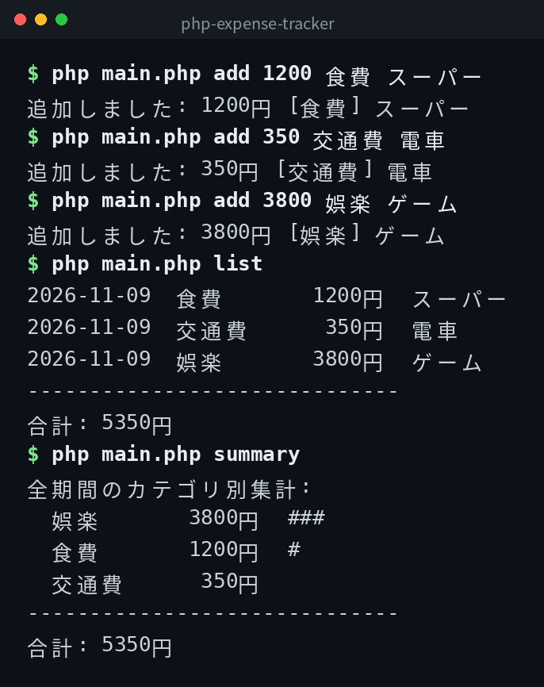

English | [日本語](ja/README.md) | [한국어](ko/README.md)

# php-expense-tracker


## Overview

A simple command-line expense tracking tool. You can add expenses, list them, and view summaries by category. Data is stored in `expenses.csv`.

## Demo



*Actual output. The CLI interface is in Japanese.*

## Features

- Add expenses with amount, category, and an optional memo
- List all expenses, optionally filtered by month
- View category-based summaries, optionally filtered by month
- Data is persisted in CSV format

## Requirements

- PHP 8.1 or higher

## Quick Start

```bash
git clone https://github.com/mivork/php-expense-tracker.git
cd php-expense-tracker
php main.php add 1200 食費 スーパー
php main.php list
```

Categories are specified in Japanese (see the Categories section below).

## Usage

| Command | Description |
|---|---|
| `add <amount> <category> [memo]` | Add an expense |
| `list [--month YYYY-MM]` | List expenses |
| `summary [--month YYYY-MM]` | Show summary by category |

## Categories

食費 (Food) / 交通費 (Transportation) / 日用品 (Daily Necessities) / 娯楽 (Entertainment) / 通信費 (Telecommunications) / 家賃 (Rent) / 光熱費 (Utilities) / その他 (Other)

## Data Format

Expenses are stored in `expenses.csv` in CSV format. The columns are `date,category,amount,memo`.

```csv
date,category,amount,memo
2026-11-09,食費,1200,スーパー
2026-11-09,交通費,350,電車
```

## License

This project is licensed under the MIT License.
