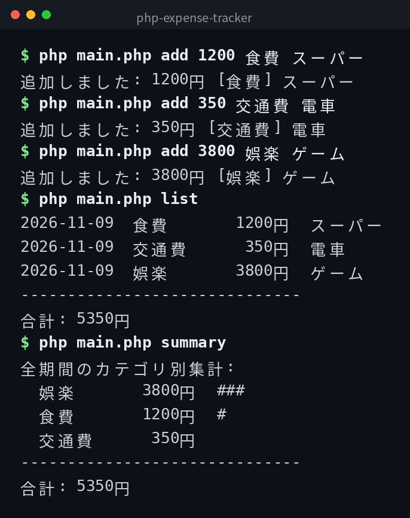

[English](../README.md) | 日本語 | [한국어](../ko/README.md)

# php-expense-tracker


## 概要

コマンドラインで動くシンプルな家計簿ツールです。支出の追加・一覧表示・カテゴリ別集計ができます。データは `expenses.csv` に保存されます。

## デモ



## Features

- 金額・カテゴリ・メモを指定して支出を追加できる
- 支出の一覧を表示できる（月別フィルタ対応）
- カテゴリ別の集計を表示できる（月別フィルタ対応）
- データは CSV 形式で永続化される

## 必要環境

- PHP 8.1 以上

## Quick Start

```bash
git clone https://github.com/mivork/php-expense-tracker.git
cd php-expense-tracker
php main.php add 1200 食費 スーパー
php main.php list
```

## コマンド一覧

| コマンド | 説明 |
|---|---|
| `add <金額> <カテゴリ> [メモ]` | 支出を追加する |
| `list [--month YYYY-MM]` | 支出一覧を表示する |
| `summary [--month YYYY-MM]` | カテゴリ別集計を表示する |

## カテゴリ

食費 / 交通費 / 日用品 / 娯楽 / 通信費 / 家賃 / 光熱費 / その他

## データ形式

`expenses.csv` に CSV 形式で保存されます。列は `date,category,amount,memo` です。

```csv
date,category,amount,memo
2026-11-09,食費,1200,スーパー
2026-11-09,交通費,350,電車
```

## ライセンス

このプロジェクトは MIT ライセンスの下で公開されています。
