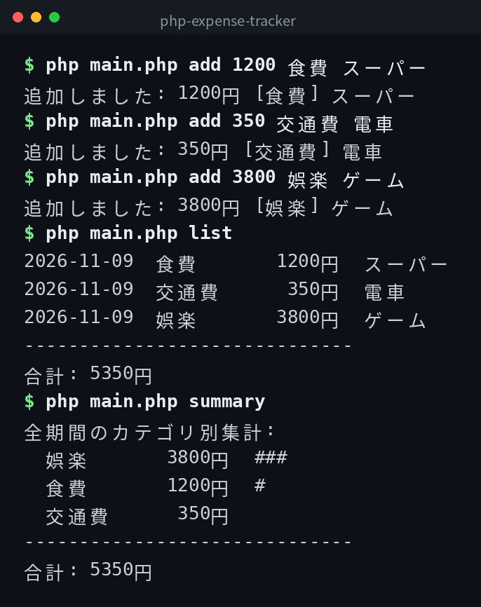

[English](../README.md) | [日本語](../ja/README.md) | 한국어

# php-expense-tracker


## 개요

커맨드라인에서 동작하는 간단한 가계부 도구입니다. 지출 추가, 목록 표시, 카테고리별 집계가 가능합니다. 데이터는 `expenses.csv`에 저장됩니다.

## 데모



*실제 출력입니다. CLI 인터페이스는 일본어입니다.*

## Features

- 금액, 카테고리, 메모를 지정하여 지출을 추가할 수 있음
- 지출 목록을 표시할 수 있음 (월별 필터 지원)
- 카테고리별 집계를 표시할 수 있음 (월별 필터 지원)
- 데이터는 CSV 형식으로 저장됨

## 필요 환경

- PHP 8.1 이상

## Quick Start

```bash
git clone https://github.com/mivork/php-expense-tracker.git
cd php-expense-tracker
php main.php add 1200 食費 スーパー
php main.php list
```

카테고리는 일본어로 지정합니다 (아래 카테고리 섹션 참조).

## 사용법

| 명령어 | 설명 |
|---|---|
| `add <금액> <카테고리> [메모]` | 지출을 추가한다 |
| `list [--month YYYY-MM]` | 지출 목록을 표시한다 |
| `summary [--month YYYY-MM]` | 카테고리별 집계를 표시한다 |

## 카테고리

食費 (식비) / 交通費 (교통비) / 日用品 (생활용품) / 娯楽 (오락) / 通信費 (통신비) / 家賃 (집세) / 光熱費 (공과금) / その他 (기타)

## 데이터 형식

`expenses.csv`에 CSV 형식으로 저장됩니다. 열은 `date,category,amount,memo`입니다.

```csv
date,category,amount,memo
2026-11-09,食費,1200,スーパー
2026-11-09,交通費,350,電車
```

## 라이선스

이 프로젝트는 MIT 라이선스 하에 공개되어 있습니다.
